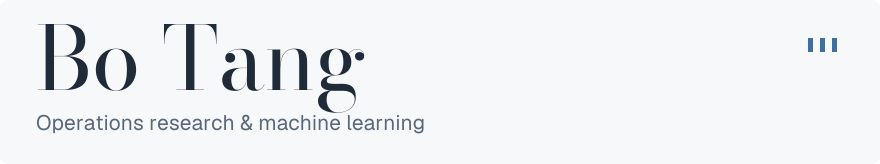
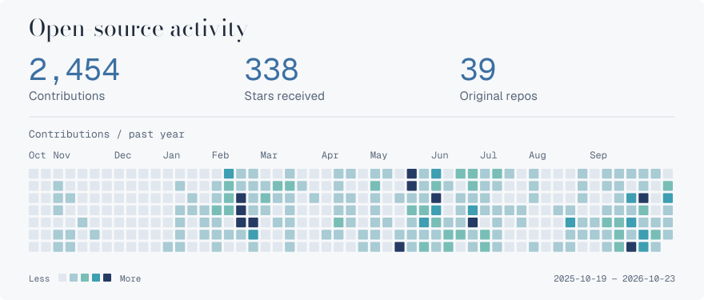
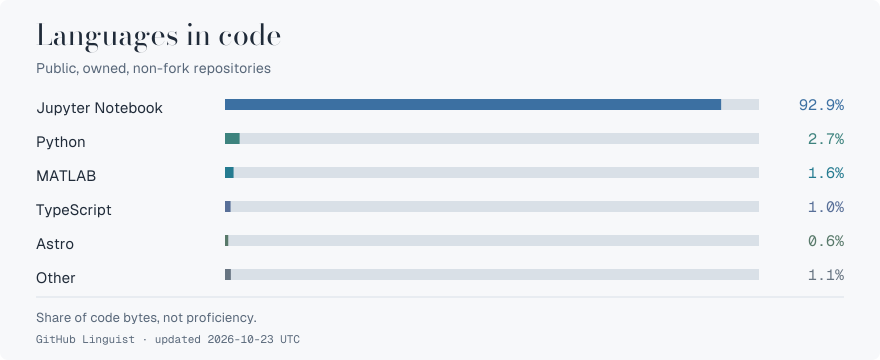

<picture>
  <source media="(prefers-color-scheme: dark) and (max-width: 600px)" srcset="assets/header-dark-mobile.svg">
  <source media="(max-width: 600px)" srcset="assets/header-light-mobile.svg">
  <source media="(prefers-color-scheme: dark)" srcset="assets/header-dark.svg">
  
</picture>

Postdoctoral Associate at the **Massachusetts Institute of Technology**.

My work draws on machine learning and modern computing to develop reliable and scalable methods and reusable computational frameworks for decision-making.

[Website](https://botang.org) · [Research](https://botang.org/research/) · [Google Scholar](https://scholar.google.com/citations?user=QMzZalQAAAAJ&hl=en) · [Email](mailto:botang@mit.edu)

<picture>
  <source media="(prefers-color-scheme: dark) and (max-width: 600px)" srcset="assets/activity-dark-mobile.svg">
  <source media="(max-width: 600px)" srcset="assets/activity-light-mobile.svg">
  <source media="(prefers-color-scheme: dark)" srcset="assets/activity-dark.svg">
  
</picture>

<picture>
  <source media="(prefers-color-scheme: dark) and (max-width: 600px)" srcset="assets/languages-dark-mobile.svg">
  <source media="(max-width: 600px)" srcset="assets/languages-light-mobile.svg">
  <source media="(prefers-color-scheme: dark)" srcset="assets/languages-dark.svg">
  
</picture>

Stars and language totals cover my public, non-fork repositories, including archived repositories. Contributions follow GitHub’s calendar. Language share measures code bytes, not proficiency. Figures refresh daily.
